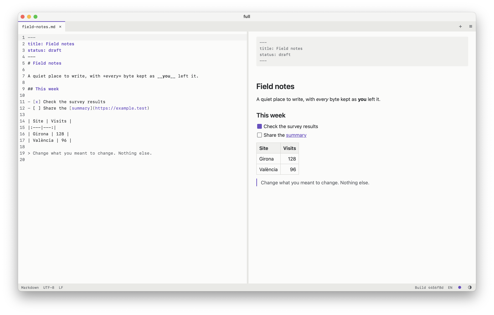

<p align="center">
  <a href="https://full.marcos-a.com">
    <picture>
      <source media="(prefers-color-scheme: dark)" srcset="public/logo-lockup-on-dark.svg">
      
    </picture>
  </a>
</p>

<h3 align="center">Tot el fitxer, tal com el vas deixar.</h3>

<p align="center">
  Obre, llegeix, edita i desa fitxers CSV, Markdown i de text, directament al navegador o al Mac.<br>
  <a href="https://full.marcos-a.com"><strong>Obre l'aplicació</strong></a> · <a href="#app-per-a-mac">Baixa l'app per a Mac</a>
</p>

<p align="center">
  <a href="README.md">English</a> · <strong>Català</strong>
</p>

<br>

<picture>
  <source media="(prefers-color-scheme: dark)" srcset="docs/screenshots/markdown-dark.png">
  
</picture>

<br>

## Per què «full»

**full** — *sheet* en anglès: *un full* per a les teves notes, *un full de càlcul* per a les teves taules. La marca és una F que també és aquest full, amb una cantonada doblegada. El fitxer és tot el que importa, i la resta no li fa nosa.

| **Tot ell** | **Només ell** | **Només teu** |
|:---|:---|:---|
| El que no has canviat es manté byte a byte: cometes, codificació, terminacions de línia, tot. Editar una cel·la només reescriu aquell camp. | El fitxer omple la finestra. No hi ha barres d'eines ni decoració, només tons discrets amb un sol color d'accent. | Els fitxers es queden al navegador. No hi ha cap compte ni cap pujada, i un tancament abrupte no et fa perdre la feina. |

<br>

<picture>
  <source media="(prefers-color-scheme: dark)" srcset="docs/screenshots/csv-dark.png">
  
</picture>

## Què fa

- **Taules:** una graella CSV que admet 100.000 files. Selecciona, redimensiona, ajusta, insereix, elimina i arrossega files i columnes com en un full de càlcul. El punt i coma, la coma decimal i el Windows-1252 de les exportacions d'Excel en espanyol i en català funcionen sense configurar res.
- **Markdown:** vistes de codi font i renderitzada una al costat de l'altra, totes dues editables, amb un únic historial de desfer compartit. El text font és sempre l'única font de veritat.
- **Text:** un editor senzill amb números de línia, cerca i ajust de línia.
- **Codi:** Python, JavaScript, TypeScript, HTML, CSS, C, C++, Java, Rust, Go, PHP, JSON, YAML, XML, SVG i scripts de shell s'obren en color, segons l'extensió del fitxer. En HTML, XML, SVG i PHP, en escriure `</` es completa l'etiqueta de tancament. Els fitxers molt grans, i els que tenen línies molt llargues, com els minificats, s'obren sense color perquè escriure continuï sent instantani.
- **Desament fidel:** l'UTF-8, l'UTF-16 i el Windows-1252 es detecten i es conserven, juntament amb qualsevol BOM i les terminacions de línia. Si un caràcter no es pot representar en la codificació, el desament s'atura i et pregunta què vols fer.
- **Recuperació:** fins a 10 fitxers tancats de manera abrupta t'esperen la pròxima vegada que obris l'aplicació, tant si tenen canvis sense desar com si no.
- **Fitxers eliminats:** a Chrome, Edge i l'aplicació per a Mac, si s'elimina del disc un fitxer que tens obert, la pestanya torna a marcar-se com a no desada en un parell de segons, en tancar-la et pregunta què vols fer, i «Save» el torna a posar on era.
- **Fitxers nous:** comença a escriure de seguida en un fitxer sense nom, i tria'n el nom i el tipus només quan el desis, fins i tot mentre n'hi ha d'altres pendents de recuperar.
- **Els teus colors:** temes clar i fosc que segueixen el sistema, i cinc tons d'accent.
- **El teu idioma:** la interfície és en català o en anglès, segons el navegador.

Les poques excepcions al «byte a byte» s'enumeren a [Limitacions conegudes](#limitacions-conegudes). [docs/original-spec.md](docs/original-spec.md) és l'encàrrec original; les decisions posteriors hi van més enllà. El nom del producte només és a [src/config.ts](src/config.ts).

## Teclat

| Acció | Tecles |
|---|---|
| Paleta d'ordres | Cmd/Ctrl+K |
| Obre un fitxer | Cmd/Ctrl+O |
| Fitxer nou | Alt+N, i també Cmd+N a l'app de Mac |
| Fitxer Markdown, CSV o de text nou | Alt+M, Alt+C, Alt+T |
| Desa, anomena i desa | Cmd/Ctrl+S, Cmd/Ctrl+Shift+S |
| Desfés, refés | Cmd/Ctrl+Z, Cmd/Ctrl+Shift+Z |
| Selecciona tot el text | Cmd/Ctrl+A |
| Tanca el fitxer | Alt+W |
| Graella: edita una cel·la | Enter, F2 o comença a escriure |
| Graella: línia nova dins d'una cel·la | Alt+Enter |
| Graella: selecciona fila, columna, tot | Shift+Espai, Ctrl+Espai, Cmd/Ctrl+A |
| Graella: mou files o columnes | Ordres «Mou les files seleccionades…» i «Mou les columnes seleccionades…» de la paleta |
| Graella: redimensiona la columna o la fila | Alt+Shift+Fletxes, o arrossega'n la vora |
| Graella: ajusta la columna o la fila al contingut | Doble clic a la vora |
| Graella: insereix o elimina les files o columnes seleccionades | Cmd/Ctrl+Alt+=, Cmd/Ctrl+Alt+- |

Totes les ordres són a la paleta i al menú del final de la barra de pestanyes. La pantalla d'inici i el text emergent del menú mostren la drecera de la paleta, tot i que a les pantalles tàctils la pantalla d'inici no la mostra.

El botó + del final de la barra de pestanyes mostra les maneres d'obrir o crear un fitxer. Un fitxer nou s'obre sense preguntar res: «Fitxer nou», a la pantalla d'inici, en aquest menú o a la paleta, et dona una pestanya buida anomenada «untitled» per escriure-hi. S'hi queda, protegida per la recuperació, fins que la desis o la descartis. L'extensió que li posis en desar-la decideix si continua com a Markdown, CSV o text. Desar sense extensió mostra un avís que pots passar per alt o desactivar, i s'obre qualsevol fitxer de text, com a text pla si no té extensió o no se'n coneix l'extensió. Els fitxers binaris, com les imatges, es rebutgen. A l'app per a Mac, el primer cop que desis un fitxer que no sigui CSV, Markdown o de text, et preguntarà abans amb un diàleg natiu que n'indica la ruta completa. Per començar amb un tipus ja triat, fes servir «Fitxer Markdown nou», «Fitxer CSV nou» o «Fitxer de text nou». Un CSV nou s'obre com una taula petita, amb punt i coma si la configuració regional fa servir la coma com a separador decimal, i amb CRLF i un BOM UTF-8 perquè Excel el llegeixi correctament. Els fitxers pendents de recuperar es queden a la llista fins que els restauris o els descartis, de manera que pots obrir o crear altres fitxers primer.

Tria un to d'accent (violeta, el predeterminat, o blau, verd, taronja o corall) amb el punt de la barra d'estat. S'aplica als dos temes, al logotip, a la icona de la pestanya i als colors dels fitxers Markdown, i es recorda. A Safari i a les aplicacions instal·lades, les icones continuen sent violetes, perquè fan servir fitxers d'imatge fixos.

L'aplicació segueix l'ajust clar o fosc del sistema. El botó de mig cercle de la barra d'estat canvia a l'altre tema i recorda l'elecció. Si tornes al tema que té el sistema, l'aplicació torna a seguir el sistema, igual que amb «Tema: segueix el sistema» de la paleta.

La interfície fa servir el primer dels idiomes del navegador que té disponible, català o anglès, i si no, l'anglès. Per canviar-lo, fes clic a l'etiqueta de l'idioma (CA o EN) de la barra d'estat, o fes servir «Idioma: Català» o «Idioma: English» de la paleta. L'elecció es recorda, i si tries l'idioma del navegador, l'aplicació torna a seguir el navegador.

A la graella, fes clic al número d'una fila o a la lletra d'una columna per seleccionar-la, i arrossega per sobre de diverses per seleccionar-les. Shift+clic amplia la selecció i Cmd/Ctrl+clic afegeix o treu files o columnes separades. Arrossega des de dins d'una selecció per moure-la sencera, i prem Escape per cancel·lar. Si n'hi ha diverses de seleccionades, arrossegar o fer doble clic a la vora de qualsevol d'elles les redimensiona totes. Fes clic amb el botó dret per obrir un menú per inserir, eliminar, ajustar o definir una mida exacta; en una pantalla tàctil, toca. L'alçada de les files i l'amplada de les columnes només canvien la vista i mai es desen al fitxer, i desfer reverteix un canvi de mida com qualsevol altre canvi.

## Compatibilitat amb navegadors

| Navegador | Desa | Anomena i desa |
|---|---|---|
| Chrome, Edge | Sobreescriu el fitxer original | Diàleg de desament natiu |
| Safari, Firefox | Descarrega una còpia, amb l'etiqueta «Descarrega» | Descàrrega amb un nom editable |

Cal HTTPS o `localhost`: sobreescriure fitxers, Web Locks i el porta-retalls asíncron només funcionen en un context segur.

## App per a Mac

full també funciona com a app nativa per a Mac, compilada a partir del mateix codi que el lloc web. Baixa-la de la [darrera versió publicada](https://github.com/Marcos-A/full/releases/latest). No és a l'App Store i Apple no l'ha revisada, així que comprova la descàrrega com s'explica més avall abans d'instal·lar-la.

<picture>
  <source media="(prefers-color-scheme: dark)" srcset="docs/screenshots/mac-app-dark.png">
  
</picture>

**Què afegeix respecte al lloc web:**

- Fes doble clic en un fitxer Markdown o CSV al Finder, o fes servir «Obre amb», per obrir-lo a full. El Finder també l'ofereix a «Obre amb» per a qualsevol altre fitxer de text, com ara `.txt`, HTML o Python, sense convertir-la en l'app per defecte. Per fer-la l'app per defecte d'un d'aquests tipus, fes servir «Obtén informació» i «Canvia-ho tot», com s'explica més avall. Un fitxer sense extensió no compta com a text per a macOS, així que el Finder no ofereix full per obrir-lo: arrossega'l a la finestra de full o a la seva icona del Dock, o fes servir «Open file» a full.
- Desa sempre sobre el fitxer original, conservant-ne els permisos, les etiquetes del Finder i la data de creació, i pregunta abans si una altra app l'ha canviat mentrestant.
- Menús natius, en anglès o en català, segons l'idioma de l'app.
- Funciona del tot sense connexió i no carrega mai el lloc web.
- Tancar la finestra, Cmd+Q, sortir des del Dock i tancar la sessió pregunten primer pels fitxers sense desar. Forçar la sortida, una fallada o un tall de corrent no es poden aturar, i la recuperació s'encarrega d'aquests casos: conserva tot el que hi ha fins a mig segon després de deixar d'escriure, i com a màxim 3 segons enrere si escrius sense parar.

**Requisits:** macOS 15 o posterior, amb Apple Silicon o Intel. Només s'ha provat a mà amb Apple Silicon, i la versió per a Intel només l'ha iniciada la compilació automàtica.

### Comprovar la descàrrega

L'app no té signatura d'Apple, que costa 99 dòlars l'any, així que macOS no pot dir-te qui l'ha feta. Aquestes comprovacions fan aquesta feina. Cada versió publicada és immutable: un cop publicada, els fitxers no es poden substituir, i GitHub en guarda un registre signat. El DMG també té un registre signat del flux de treball i del commit que l'han compilat.

1. Baixa el DMG de la [darrera versió publicada](https://github.com/Marcos-A/full/releases/latest). El nom acaba amb la versió i la compilació, com ara `full_0.1.0_universal_563745f.dmg`.
2. **Comprovació ràpida, sense instal·lar res.** Obre el Terminal (a Aplicacions > Utilitats), escriu `shasum -a 256` i un espai, arrossega el DMG a la finestra del Terminal i prem Retorn. El codi llarg que mostra ha de coincidir amb el `sha256:` que surt al costat del DMG a la pàgina de la versió. Això demostra que el teu fitxer és el que s'hi ha publicat.
3. **Comprovació completa, amb un compte de GitHub.** Instal·la el [GitHub CLI](https://cli.github.com) (`brew install gh` amb Homebrew) i executa `gh auth login` una vegada. Després executa aquestes línies al Terminal, amb la versió publicada a la segona:

   ```
   cd ~/Downloads
   gh release verify-asset v0.1.0 full_*.dmg --repo Marcos-A/full
   gh attestation verify full_*.dmg --repo Marcos-A/full --signer-workflow Marcos-A/full/.github/workflows/desktop.yml --source-ref refs/heads/main
   ```

   Si a Baixades hi ha més d'un DMG de full, escriu el nom sencer del fitxer en lloc de `full_*.dmg`. Totes dues comprovacions han de dir que la verificació ha anat bé. La primera demostra que el fitxer pertany a aquella versió. La segona, que l'ha compilat el flux de treball d'aquest repositori als servidors de GitHub, a partir de la branca `main`, i no l'ordinador de ningú.

Si una comprovació falla, no instal·lis l'app i [obre una incidència](https://github.com/Marcos-A/full/issues).

Aquestes comprovacions demostren que l'app s'ha compilat a partir del codi públic d'aquest repositori, sense res afegit pel camí. No demostren que aquest codi sigui segur, cosa que has de valorar tu, i a diferència de la notarització d'Apple, ningú no l'ha analitzat per detectar-hi programari maliciós.

### Com instal·lar-la

macOS no obrirà l'app fins que li ho indiquis. Fes-ho només amb una descàrrega que hagi superat les comprovacions anteriors.

1. Fes doble clic al DMG i arrossega `full` a la carpeta Aplicacions. Després expulsa el DMG des del Finder.
2. Obre el Terminal (a Aplicacions > Utilitats), enganxa aquesta línia i prem Retorn:

   ```
   xattr -dr com.apple.quarantine /Applications/full.app
   ```

   Això indica a macOS que se salti la comprovació de baixades només per a aquesta app.
3. Obre full des d'Aplicacions. La barra d'estat de la part inferior mostra la versió i la compilació.

Perquè full obri tots els teus fitxers Markdown amb doble clic, selecciona'n un al Finder, prem Cmd+I, tria full a «Obre amb» i fes clic a «Canvia-ho tot». Amb els fitxers CSV i amb qualsevol altre tipus de fitxer de text, com ara `.txt`, `.html` o `.py`, funciona igual.

**Actualitzar-la:** surt de full, baixa i comprova el DMG nou, i repeteix els passos d'instal·lació, substituint l'app antiga. Els fitxers pendents de recuperar es conserven. L'app no s'actualitza sola.

**Eliminar-la:** arrossega `full` des d'Aplicacions a la paperera. Les dades de recuperació són a `~/Library/WebKit/com.marcos-a.full/`, i la llista de fitxers que es poden restaurar és a `~/Library/Application Support/com.marcos-a.full/`. Esborra totes dues carpetes per eliminar-ho tot.

**Privadesa:** res no surt del Mac. Les dades de recuperació es queden al Mac sense xifrar, com les del lloc web en un navegador. Per desar un fitxer restaurat sobre l'original, l'app guarda una llista en text pla de les rutes dels fitxers que ha obert.

## Privadesa i ordinadors compartits

L'aplicació no fa cap petició que contingui el contingut dels fitxers, i no té analítiques ni informes d'errors externs. Les imatges remotes del Markdown es bloquegen fins que executes «Carrega les imatges remotes d'aquest fitxer», perquè carregar-les revela la teva adreça IP a aquells servidors.

**Les dades de recuperació es desen sense xifrar al perfil del navegador**, fins i tot les dels fitxers que no has editat mai. En un ordinador compartit, executa «Esborra totes les dades de recuperació» des de la llista de recuperació quan acabis, cosa que les elimina del tot. Els fitxers encara oberts en una altra pestanya no es veuen afectats fins que es tanca aquella pestanya.

---

## Desenvolupament

No cal tenir Node ni navegadors a l'amfitrió: [scripts/in-docker.sh](scripts/in-docker.sh) executa qualsevol ordre a la imatge de Playwright.

```sh
scripts/in-docker.sh sh -c 'mkdir -p /tmp/home && npm ci'
scripts/in-docker.sh npm test                 # proves unitàries (Vitest)
scripts/in-docker.sh npm run test:e2e         # Chromium, Firefox, WebKit
scripts/in-docker.sh npm run test:perf        # objectius de temps, en una màquina sense altra càrrega
```

Totes dues ordres de Playwright compilen primer i després proven aquesta compilació de producció mitjançant `vite preview`, amb la Content Security Policy real. Engeguen els seus propis servidors i s'aturen si els ports ja estan ocupats, de manera que no poden acabar provant una altra còpia del repositori. Per comprovar el lloc desplegat:

```sh
BASE_URL=https://full.marcos-a.com scripts/in-docker.sh npx playwright test --project=chromium e2e/privacy.spec.ts
```

`test:e2e` també executa els fluxos de desament a WebKit amb un substitut de l'accés natiu a fitxers de l'app d'escriptori. `npm run build` el compila en un paquet separat, `dist-native-fake/`, que no arriba mai al lloc web.

L'[app per a Mac](#app-per-a-mac) fa servir Tauri 2 i el mateix frontend que el lloc web: la part nativa és a `src-tauri/` i el seu punt d'entrada a `src/desktop/`. El seu paquet va a `dist-desktop/`, que no arriba mai al lloc web, i s'empaqueta dins de l'app, de manera que l'app no carrega mai el lloc desplegat.

Els seus menús vénen de `src-tauri/src/menu_table.rs`, i la pàgina només indica quins elements s'apliquen. Per desar un fitxer restaurat sobre l'original, l'app demana una confirmació nativa que indica la ruta, a partir d'una llista que Rust guarda a `~/Library/Application Support/com.marcos-a.full/`. Si s'inicia amb `FULL_TIMINGS` definida, escriu a stderr els temps d'inici, obertura, escriptura i desament; l'[auditoria](docs/desktop/repository-audit.md#m6-finder-and-packaging-results) explica com es van mesurar els pressupostos.

Les compilacions s'executen a GitHub Actions amb [desktop.yml](.github/workflows/desktop.yml), a cada push a una branca `desktop-*`, o des de la pàgina d'Actions quan el flux de treball sigui a `main`. Prova el codi natiu, genera un DMG universal i comprova que l'app compilada s'inicia, també amb Rosetta. També pregunta a macOS per a quins tipus de fitxer oferiria l'app. Produeix `full-dmg-<commit>` i `full-inspector-dmg-<commit>`, la mateixa app amb el nom «full inspector» i Web Inspector activat, per llegir errors de la consola en un Mac. Té el seu propi identificador, `com.marcos-a.full.inspector`, perquè macOS no hi obri mai els fitxers destinats a full, i conserva les seves pròpies dades de recuperació. Tots dos tenen una signatura ad hoc, així que només serveixen per fer proves. Els noms dels DMG també acaben amb el commit, perquè una baixada antiga no es pugui confondre amb una de nova.

CI esborra aquests fitxers al cap de 14 dies. Per conservar una compilació, obre la pàgina d'Actions, tria Desktop build i després Run workflow, selecciona la branca i marca «release». Quan acabi, el DMG és a Releases com a `mac-<commit>`, marcat com a prellançament, amb el seu SHA-256 al costat. Com el repositori, les versions publicades són privades.

Per publicar una versió, executa'l a `main` escrivint la versió a la casella «version», com ara `v0.1.0`, igual que a `package.json`. Cal que el repositori sigui públic i que «Enable release immutability» estigui activat a la seva configuració, i ho comprova tot abans de compilar. Aleshores la compilació rep una atestació signada del flux de treball i del commit d'on surt, la barra d'estat de l'aplicació mostra la versió, i la versió publicada ja no es pot canviar. L'últim pas fa les comprovacions de [Comprovar la descàrrega](#comprovar-la-descàrrega).

En un Mac amb Rust i les eines d'Xcode, fes servir `npm run desktop:dev`, `desktop:build` i `desktop:test`.

Amb Node 24 o posterior instal·lat, `npm run dev` inicia un servidor de desenvolupament. Fes servir les mateixes versions per a les proves: les versions més antigues de Node, com ara la 22.16, descodifiquen malament el Windows-1252, cosa que fa fallar les proves de codificació encara que als navegadors funcioni bé. Per SSH, fes servir un túnel a `localhost` perquè la pàgina continuï sent un context segur.

Les captures de pantalla del README surten de la compilació actual i fan servir dades de mostra, així que torna a fer-les sempre que canviï la interfície:

```sh
scripts/in-docker.sh npm run docs:screenshots
```

La versió de Playwright de `package.json` i l'etiqueta de la imatge de `scripts/in-docker.sh` han de coincidir.

## Desplegament

El lloc funciona com un contenidor nginx que serveix els fitxers compilats, vinculat a un port de localhost darrere del proxy invers de l'amfitrió, que s'encarrega del TLS. La imatge es construeix íntegrament a Docker.

| Paràmetre | Valor predeterminat | Variable |
|---|---|---|
| Port de l'amfitrió | `8098` | `HOST_PORT` |
| Nom del contenidor | `full-web` | `CONTAINER_NAME` |
| Imatge | `full-web:local` | `IMAGE_NAME` |

**Primer desplegament:** apunta el proxy invers al port, per exemple amb Caddy:

```caddyfile
full.marcos-a.com {
	reverse_proxy 127.0.0.1:8098
}
```

**Desplega o actualitza:**

```sh
git pull
scripts/deploy_production.sh
```

L'script rebutja els canvis sense confirmar, construeix la imatge amb l'SHA del commit, inicia el contenidor, escriu les metadades de compilació i comprova que el contenidor respon. Les capçaleres de seguretat i de memòria cau es defineixen a [deploy/nginx.conf](deploy/nginx.conf) i [deploy/security-headers.conf](deploy/security-headers.conf).

**Torna enrere:**

```sh
git checkout <commit>
scripts/deploy_production.sh
git checkout main
```

**Mantén l'origen estable.** Les dades de recuperació pertanyen a l'origen, de manera que si canvies el domini, el subdomini o el port, es queden enrere.

## Informació de compilació

La barra d'estat mostra el commit desplegat, com ara `Build 05f2e39`, o `v1.0.0 · 05f2e39` quan ja hi ha una versió publicada. Si falten les metadades, mostra `Build unknown` i l'aplicació funciona amb normalitat. Les metadades completes són a `/build-info.json`.

L'script de desplegament escriu aquest fitxer a `build-meta/` a l'amfitrió, que el contenidor munta només de lectura. Els desplegaments no creen versions. Després de publicar una versió a GitHub, actualitza el que es mostra sense recompilar:

```sh
scripts/write-build-info.sh "$(git rev-parse HEAD)"
```

La compilació de l'app per a Mac escriu el mateix fitxer dins del seu paquet, amb `desktop` com a entorn i sense cap versió fins que l'app en tingui una de publicada. El seu número de versió, de moment `0.1.0`, surt de `package.json` i es veu al Finder.

`build-env.sh` i `update-release-info.sh` són còpies de la convenció compartida `app-build-info`, així que canvia-les allà i no aquí.

## Recursos de marca

Les icones, els logotips i el manifest web són a [public/](public/).

## Proves i comprovacions manuals

La suite de Playwright cobreix cada criteri d'acceptació de la secció 11 de l'[encàrrec original](docs/original-spec.md); els noms de les proves comencen pel seu número, com ara `AC14`. Les proves marcades amb `@cross` també s'executen a Firefox i WebKit.

Els diàlegs natius de fitxers no es poden automatitzar, de manera que les proves de sobreescriure l'original només simulen els selectors i escriuen mitjançant objectes `FileSystemFileHandle` reals del sistema de fitxers privat del navegador. Aquestes comprovacions necessiten un navegador real i encara s'han de fer:

| Comprovació | Passos | Resultat |
|---|---|---|
| Sobreescriptura després del permís | A Chrome o Edge: obre un fitxer amb el botó, edita'l, desa'l, accepta l'avís i comprova el fitxer al disc | Encara no s'ha fet |
| L'arrossegament conserva l'identificador | A Chrome o Edge: arrossega un fitxer des de l'escriptori, edita'l, desa'l i comprova que se sobreescriu sense cap diàleg de desament | Encara no s'ha fet |
| Permís després de restaurar | Restaura un fitxer després d'una fallada i desa'l: hauria de demanar permís i, si es denega, recórrer a «Anomena i desa» | Superada a Edge: desar sobre el fitxer després de permetre-ho i el recurs a «Anomena i desa» |
| Enganxar a fulls de càlcul | Copia un interval i enganxa'l a Excel, Google Sheets i Word; copia des d'Excel i enganxa a la graella | Encara no s'ha fet |
| Tecles mortes | En un teclat espanyol o català, escriu `à` directament en una cel·la seleccionada de la graella. La prova compon el text a través de Chromium i no envia cap tecla real | Superada amb un teclat real a Safari, Chrome i la prova per a Mac |
| Safari real | Repeteix el flux principal a Safari. Les execucions automatitzades fan servir la compilació WebKit de Playwright | Encara no s'ha fet |
| Shell de l'app per a Mac | Amb la xarxa desactivada, obre l'app per a Mac; a la compilació amb l'inspector, comprova que la consola no mostra infraccions de la CSP; fes clic a enllaços web i de correu | Superada a macOS 26.7.1, compilació `fd4494c` |
| Obertura a l'app per a Mac | Amb el tauler d'obrir, arrossegant des del Finder i amb `open -a`, obre fitxers compatibles, no compatibles i ja oberts; des de la consola de la compilació amb l'inspector, intenta llegir una ruta | Superada a l'M4, compilació `b819dad`. El doble clic real i «Obre amb» es van superar a l'M6 |
| Desament a l'app per a Mac | Edita i desa sobre els originals, també en una carpeta d'iCloud; canvia un fitxer des d'una altra app i prova cada opció del conflicte; desa un fitxer només de lectura i un de bloquejat; comprova que es mantenen el mode, les etiquetes i la data de creació | Superada a l'M4, compilació `8906b37` |
| Tancament i sortida de l'app per a Mac | Amb el botó vermell, Cmd+Q i sortint des del Dock, prova Cancel·la, No desis, Desa i un desament que falli; tanca la sessió amb canvis sense desar; comprova Cmd+W i Opció+W; força la sortida, restaura sense xarxa i desa; instal·la una versió superior a sobre i restaura | Superada a l'M4, compilacions `461ec0a` i `0ccf8f4`, i `2a77728` per a l'actualització |
| L'app per a Mac al Finder | En un usuari de macOS nou i amb la Wi-Fi desactivada, fes doble clic en un fitxer amb l'app tancada i en un altre amb l'app oberta; fes servir «Obre amb», en fred i en calent; comprova que `.txt` ofereix l'app sense que sigui la predeterminada, i que `.py` no; deixa anar fitxers compatibles i no compatibles junts; desa | Superada a l'M4, compilació `52a2de0` |
| Menús de l'app per a Mac | Fes servir tots els elements dels menús File, View, Table, Edit i Window, inclòs Select All en una taula i en una cel·la; canvia l'app al català; comprova que Cmd+W, Cmd+Q i sortir des del Dock encara pregunten | Superada a l'M4, compilacions `52a2de0` i `563745f` |
| Altres fitxers de text a l'app per a Mac | Obre des del Finder un `.py`, un `.html` i un fitxer sense extensió; comprova que es rebutja una imatge; edita'ls i desa'ls, cosa que ha de preguntar un sol cop amb un diàleg natiu que indica la ruta; fes «Anomena i desa» amb un nom sense extensió i comprova que es queda tal com l'has escrit; fes que full sigui l'app per defecte dels `.py` amb «Canvia-ho tot» | Superada a l'M4, compilació `4456f8d`. El Finder no ofereix full per al fitxer sense extensió, perquè macOS no el compta com a text; arrossegant-lo a full s'obre |
| Fitxer eliminat | Amb un fitxer desat obert a l'app per a Mac i a Chrome o Edge, elimina'l, mou-lo a la paperera i canvia-li el nom, amb l'app al davant i al darrere. La pestanya ha de passar a no desada, en tancar-la ha de preguntar i Desa l'ha de tornar a posar on era. A Chrome, comprova si torna a la mateixa ruta o va a Anomena i desa | Superada a l'M4, compilació `4456f8d`, i a Chrome, on Desa ha tornat a posar el fitxer a la mateixa ruta |

## Limitacions conegudes

- **Terminacions de línia mixtes:** els fitxers conserven els bytes exactes fins que s'editen. La primera edició desada en un editor de codi font els pot convertir a l'estil dominant, i la barra d'estat ho avisa. Les edicions a la graella no els converteixen.
- **Cel·les CSV de diverses línies a la vista en brut:** un fitxer CRLF amb LF dins de cel·les entre cometes compta com a mixt, de manera que editar-lo a la vista en brut els pot convertir. Editar-lo a la graella, no.
- **Les edicions a la banda renderitzada canvien el format:** regeneren el Markdown del fitxer, tal com diu l'avís. L'avís no apareix en fitxers buits o que no s'han desat mai, perquè no tenen cap format existent per protegir. El front matter i l'estat del salt de línia final es conserven, i desfer restaura el text anterior exacte.
- **Desfer en CSV:** la graella i la vista en brut tenen historials separats. Els canvis fets a la vista en brut arriben a la graella com un sol pas de desfer, i sortir de la vista en brut n'esborra l'historial.
- **Moure columnes en files desiguals:** una fila més curta que la columna moguda es queda tal com està. Altrament, només guanya els camps buits necessaris perquè els valors continuïn a les columnes correctes.
- **Desfer després de restaurar:** l'historial de desfer no sobreviu a una restauració ni a un canvi de codificació.
- **Markdown molt gran:** les edicions a la banda renderitzada serialitzen tot el document, de manera que en un fitxer d'1 MB van per darrere de l'escriptura, per disseny i sense perdre mai text. Escriure a la banda del codi font no se'n veu afectat. Els fitxers de més de 100 KB s'analitzen per seccions, i es mantenen sencers si contenen alguna cosa que pugui abastar diverses seccions, com ara enllaços de referència o comentaris HTML.
- **Imatges i enllaços relatius:** les rutes relatives d'imatges mostren un marcador, perquè una pàgina del navegador no pot llegir els fitxers veïns. Els enllaços relatius no naveguen.
- **Les caselles de tasques** de la banda renderitzada es dibuixen amb CSS, així que només es marquen amb el ratolí. El seu text es pot editar amb el teclat, igual que el `[x]` del codi font.
