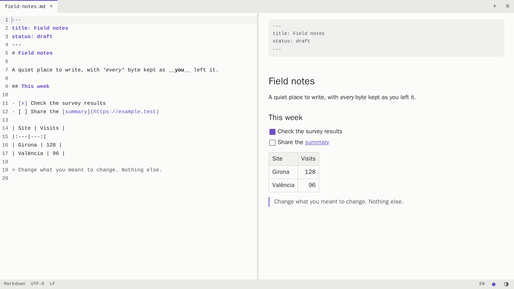
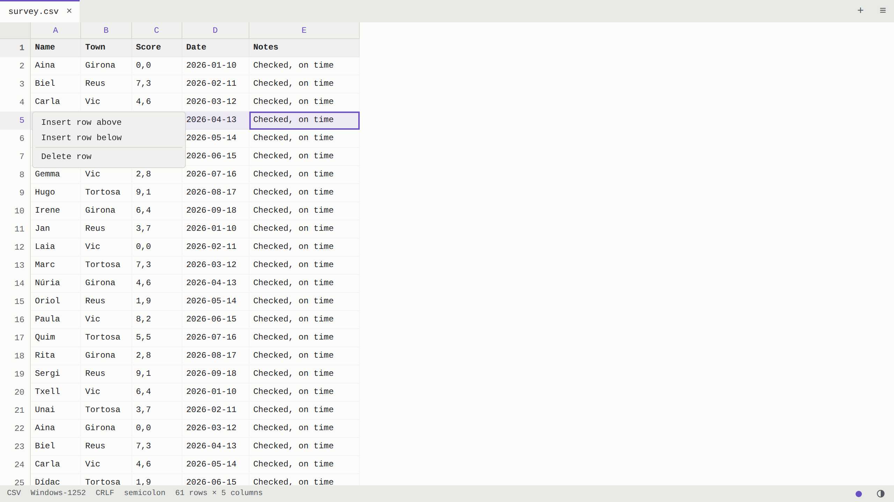

<p align="center">
  <a href="https://full.marcos-a.com">
    <picture>
      <source media="(prefers-color-scheme: dark)" srcset="public/logo-lockup-on-dark.svg">
      
    </picture>
  </a>
</p>

<h3 align="center">Tot el fitxer, tal com el vas deixar.</h3>

<p align="center">
  Obre, llegeix, edita i desa fitxers CSV, Markdown i de text, directament al navegador.<br>
  <a href="https://full.marcos-a.com"><strong>Obre l'aplicació</strong></a>
</p>

<p align="center">
  <a href="README.md">English</a> · <strong>Català</strong>
</p>

<br>

<picture>
  <source media="(prefers-color-scheme: dark)" srcset="docs/screenshots/markdown-dark.png">
  
</picture>

<br>

## Per què «full»

**full** — *sheet* en anglès: *un full* per a les teves notes, *un full de càlcul* per a les teves taules. La marca és una F que també és aquest full, amb una cantonada doblegada. El fitxer és tot el que importa, i la resta no li fa nosa.

| **Tot ell** | **Només ell** | **Només teu** |
|:---|:---|:---|
| El que no has canviat es manté byte a byte: cometes, codificació, terminacions de línia, tot. Editar una cel·la només reescriu aquell camp. | El fitxer omple la finestra. No hi ha barres d'eines ni decoració, només tons discrets amb un sol color d'accent. | Els fitxers es queden al navegador. No hi ha cap compte ni cap pujada, i un tancament abrupte no et fa perdre la feina. |

<br>

<picture>
  <source media="(prefers-color-scheme: dark)" srcset="docs/screenshots/csv-dark.png">
  
</picture>

## Què fa

- **Taules:** una graella CSV que admet 100.000 files. Insereix, elimina i arrossega files i columnes. El punt i coma, la coma decimal i el Windows-1252 de les exportacions d'Excel en espanyol i en català funcionen sense configurar res.
- **Markdown:** vistes de codi font i renderitzada una al costat de l'altra, totes dues editables, amb un únic historial de desfer compartit. El text font és sempre l'única font de veritat.
- **Text:** un editor senzill amb números de línia, cerca i ajust de línia.
- **Desament fidel:** l'UTF-8, l'UTF-16 i el Windows-1252 es detecten i es conserven, juntament amb qualsevol BOM i les terminacions de línia. Si un caràcter no es pot representar en la codificació, el desament s'atura i et pregunta què vols fer.
- **Recuperació:** fins a 10 fitxers tancats de manera abrupta t'esperen la pròxima vegada que obris l'aplicació, tant si tenen canvis sense desar com si no.
- **Fitxers nous:** crea fitxers Markdown, CSV o de text, fins i tot mentre n'hi ha d'altres pendents de recuperar.
- **Els teus colors:** temes clar i fosc que segueixen el sistema, i cinc tons d'accent.
- **El teu idioma:** la interfície és en català o en anglès, segons el navegador.

Les poques excepcions al «byte a byte» s'enumeren a [Limitacions conegudes](#limitacions-conegudes). [docs/original-spec.md](docs/original-spec.md) és l'encàrrec original; les decisions posteriors hi van més enllà. El nom del producte només és a [src/config.ts](src/config.ts).

## Teclat

| Acció | Tecles |
|---|---|
| Paleta d'ordres | Cmd/Ctrl+K |
| Desa, anomena i desa | Cmd/Ctrl+S, Cmd/Ctrl+Shift+S |
| Desfés, refés | Cmd/Ctrl+Z, Cmd/Ctrl+Shift+Z |
| Tanca el fitxer | Alt+W |
| Graella: edita una cel·la | Enter, F2 o comença a escriure |
| Graella: línia nova dins d'una cel·la | Alt+Enter |
| Graella: selecciona fila, columna, tot | Shift+Espai, Ctrl+Espai, Cmd/Ctrl+A |
| Graella: mou files o columnes | Ordres «Mou les files seleccionades…» i «Mou les columnes seleccionades…» de la paleta |
| Graella: redimensiona la columna | Alt+Shift+Esquerra/Dreta |

Totes les ordres són a la paleta i al menú del final de la barra de pestanyes. La pantalla d'inici i el text emergent del menú mostren la drecera de la paleta, tot i que a les pantalles tàctils la pantalla d'inici no la mostra.

Crea un fitxer Markdown, CSV o de text amb «Fitxer nou» a la pantalla d'inici, o amb l'ordre corresponent de la paleta. Un CSV nou s'obre com una taula petita, amb punt i coma si la configuració regional fa servir la coma com a separador decimal, i amb CRLF i un BOM UTF-8 perquè Excel el llegeixi correctament. Els fitxers pendents de recuperar es queden a la llista fins que els restauris o els descartis, de manera que pots obrir o crear altres fitxers primer.

Tria un to d'accent (violeta, el predeterminat, o blau, verd, taronja o corall) amb el punt de la barra d'estat. S'aplica als dos temes, al logotip i a la icona de la pestanya, i es recorda. A Safari i a les aplicacions instal·lades, les icones continuen sent violetes, perquè fan servir fitxers d'imatge fixos.

L'aplicació segueix l'ajust clar o fosc del sistema. El botó de mig cercle de la barra d'estat canvia a l'altre tema i recorda l'elecció. Si tornes al tema que té el sistema, l'aplicació torna a seguir el sistema, igual que amb «Tema: segueix el sistema» de la paleta.

La interfície fa servir el primer dels idiomes del navegador que té disponible, català o anglès, i si no, l'anglès. Per canviar-lo, fes clic a l'etiqueta de l'idioma (CA o EN) de la barra d'estat, o fes servir «Idioma: Català» o «Idioma: English» de la paleta. L'elecció es recorda, i si tries l'idioma del navegador, l'aplicació torna a seguir el navegador.

A la graella, fes clic al número d'una fila o a la lletra d'una columna per seleccionar-la i obrir un menú per inserir o eliminar. Prem i arrossega per moure-la a un altre lloc, i prem Escape per cancel·lar l'arrossegament. Shift+clic selecciona un interval, i arrossegar des de dins d'un interval seleccionat el mou sencer.

## Compatibilitat amb navegadors

| Navegador | Desa | Anomena i desa |
|---|---|---|
| Chrome, Edge | Sobreescriu el fitxer original | Diàleg de desament natiu |
| Safari, Firefox | Descarrega una còpia, amb l'etiqueta «Descarrega» | Descàrrega amb un nom editable |

Cal HTTPS o `localhost`: sobreescriure fitxers, Web Locks i el porta-retalls asíncron només funcionen en un context segur.

## Privadesa i ordinadors compartits

L'aplicació no fa cap petició que contingui el contingut dels fitxers, i no té analítiques ni informes d'errors externs. Les imatges remotes del Markdown es bloquegen fins que executes «Carrega les imatges remotes d'aquest fitxer», perquè carregar-les revela la teva adreça IP a aquells servidors.

**Les dades de recuperació es desen sense xifrar al perfil del navegador**, fins i tot les dels fitxers que no has editat mai. En un ordinador compartit, executa «Esborra totes les dades de recuperació» des de la llista de recuperació quan acabis, cosa que les elimina del tot. Els fitxers encara oberts en una altra pestanya no es veuen afectats fins que es tanca aquella pestanya.

---

## Desenvolupament

No cal tenir Node ni navegadors a l'amfitrió: [scripts/in-docker.sh](scripts/in-docker.sh) executa qualsevol ordre a la imatge de Playwright.

```sh
scripts/in-docker.sh sh -c 'mkdir -p /tmp/home && npm ci'
scripts/in-docker.sh npm test                 # proves unitàries (Vitest)
scripts/in-docker.sh npm run test:e2e         # Chromium, Firefox, WebKit
scripts/in-docker.sh npm run test:perf        # objectius de temps, en una màquina sense altra càrrega
```

Totes dues ordres de Playwright compilen primer i després proven aquesta compilació de producció mitjançant `vite preview`, amb la Content Security Policy real. Engeguen els seus propis servidors i s'aturen si els ports ja estan ocupats, de manera que no poden acabar provant una altra còpia del repositori. Per comprovar el lloc desplegat:

```sh
BASE_URL=https://full.marcos-a.com scripts/in-docker.sh npx playwright test --project=chromium e2e/privacy.spec.ts
```

`test:e2e` també executa els fluxos de desament a WebKit amb un substitut de l'accés natiu a fitxers de l'app d'escriptori. `npm run build` el compila en un paquet separat, `dist-native-fake/`, que no arriba mai al lloc web.

Amb Node 24 o posterior instal·lat, `npm run dev` inicia un servidor de desenvolupament. Fes servir les mateixes versions per a les proves: les versions més antigues de Node, com ara la 22.16, descodifiquen malament el Windows-1252, cosa que fa fallar les proves de codificació encara que als navegadors funcioni bé. Per SSH, fes servir un túnel a `localhost` perquè la pàgina continuï sent un context segur.

Les captures de pantalla del README surten de la compilació actual i fan servir dades de mostra, així que torna a fer-les sempre que canviï la interfície:

```sh
scripts/in-docker.sh npm run docs:screenshots
```

La versió de Playwright de `package.json` i l'etiqueta de la imatge de `scripts/in-docker.sh` han de coincidir.

## Desplegament

El lloc funciona com un contenidor nginx que serveix els fitxers compilats, vinculat a un port de localhost darrere del proxy invers de l'amfitrió, que s'encarrega del TLS. La imatge es construeix íntegrament a Docker.

| Paràmetre | Valor predeterminat | Variable |
|---|---|---|
| Port de l'amfitrió | `8098` | `HOST_PORT` |
| Nom del contenidor | `full-web` | `CONTAINER_NAME` |
| Imatge | `full-web:local` | `IMAGE_NAME` |

**Primer desplegament:** apunta el proxy invers al port, per exemple amb Caddy:

```caddyfile
full.marcos-a.com {
	reverse_proxy 127.0.0.1:8098
}
```

**Desplega o actualitza:**

```sh
git pull
scripts/deploy_production.sh
```

L'script rebutja els canvis sense confirmar, construeix la imatge amb l'SHA del commit, inicia el contenidor, escriu les metadades de compilació i comprova que el contenidor respon. Les capçaleres de seguretat i de memòria cau es defineixen a [deploy/nginx.conf](deploy/nginx.conf) i [deploy/security-headers.conf](deploy/security-headers.conf).

**Torna enrere:**

```sh
git checkout <commit>
scripts/deploy_production.sh
git checkout main
```

**Mantén l'origen estable.** Les dades de recuperació pertanyen a l'origen, de manera que si canvies el domini, el subdomini o el port, es queden enrere.

## Informació de compilació

La barra d'estat mostra el commit desplegat, com ara `Build 05f2e39`, o `v1.0.0 · 05f2e39` quan ja hi ha una versió publicada. Si falten les metadades, mostra `Build unknown` i l'aplicació funciona amb normalitat. Les metadades completes són a `/build-info.json`.

L'script de desplegament escriu aquest fitxer a `build-meta/` a l'amfitrió, que el contenidor munta només de lectura. Els desplegaments no creen versions. Després de publicar una versió a GitHub, actualitza el que es mostra sense recompilar:

```sh
scripts/write-build-info.sh "$(git rev-parse HEAD)"
```

`build-env.sh` i `update-release-info.sh` són còpies de la convenció compartida `app-build-info`, així que canvia-les allà i no aquí.

## Recursos de marca

Les icones, els logotips i el manifest web són a [public/](public/).

## Proves i comprovacions manuals

La suite de Playwright cobreix cada criteri d'acceptació de la secció 11 de l'[encàrrec original](docs/original-spec.md); els noms de les proves comencen pel seu número, com ara `AC14`. Les proves marcades amb `@cross` també s'executen a Firefox i WebKit.

Els diàlegs natius de fitxers no es poden automatitzar, de manera que les proves de sobreescriure l'original només simulen els selectors i escriuen mitjançant objectes `FileSystemFileHandle` reals del sistema de fitxers privat del navegador. Aquestes comprovacions necessiten un navegador real i encara s'han de fer:

| Comprovació | Passos | Resultat |
|---|---|---|
| Sobreescriptura després del permís | A Chrome o Edge: obre un fitxer amb el botó, edita'l, desa'l, accepta l'avís i comprova el fitxer al disc | Encara no s'ha fet |
| L'arrossegament conserva l'identificador | A Chrome o Edge: arrossega un fitxer des de l'escriptori, edita'l, desa'l i comprova que se sobreescriu sense cap diàleg de desament | Encara no s'ha fet |
| Permís després de restaurar | Restaura un fitxer després d'una fallada i desa'l: hauria de demanar permís i, si es denega, recórrer a «Anomena i desa» | Superada a Edge: desar sobre el fitxer després de permetre-ho i el recurs a «Anomena i desa» |
| Enganxar a fulls de càlcul | Copia un interval i enganxa'l a Excel, Google Sheets i Word; copia des d'Excel i enganxa a la graella | Encara no s'ha fet |
| Tecles mortes | En un teclat espanyol o català, escriu `à` directament en una cel·la seleccionada de la graella. La prova compon el text a través de Chromium i no envia cap tecla real | Encara no s'ha fet |
| Safari real | Repeteix el flux principal a Safari. Les execucions automatitzades fan servir la compilació WebKit de Playwright | Encara no s'ha fet |

## Limitacions conegudes

- **Terminacions de línia mixtes:** els fitxers conserven els bytes exactes fins que s'editen. La primera edició desada en un editor de codi font els pot convertir a l'estil dominant, i la barra d'estat ho avisa. Les edicions a la graella no els converteixen.
- **Cel·les CSV de diverses línies a la vista en brut:** un fitxer CRLF amb LF dins de cel·les entre cometes compta com a mixt, de manera que editar-lo a la vista en brut els pot convertir. Editar-lo a la graella, no.
- **Les edicions a la banda renderitzada canvien el format:** regeneren el Markdown del fitxer, tal com diu l'avís. L'avís no apareix en fitxers buits o que no s'han desat mai, perquè no tenen cap format existent per protegir. El front matter i l'estat del salt de línia final es conserven, i desfer restaura el text anterior exacte.
- **Desfer en CSV:** la graella i la vista en brut tenen historials separats. Els canvis fets a la vista en brut arriben a la graella com un sol pas de desfer, i sortir de la vista en brut n'esborra l'historial.
- **Moure columnes en files desiguals:** una fila més curta que la columna moguda es queda tal com està. Altrament, només guanya els camps buits necessaris perquè els valors continuïn a les columnes correctes.
- **Amplades de columna després de desfer:** desfer un canvi de columna restaura el contingut, però les amplades es poden quedar on eren.
- **Desfer després de restaurar:** l'historial de desfer no sobreviu a una restauració ni a un canvi de codificació.
- **Markdown molt gran:** les edicions a la banda renderitzada serialitzen tot el document, de manera que en un fitxer d'1 MB van per darrere de l'escriptura, per disseny i sense perdre mai text. Escriure a la banda del codi font no se'n veu afectat. Els fitxers de més de 100 KB s'analitzen per seccions, i es mantenen sencers si contenen alguna cosa que pugui abastar diverses seccions, com ara enllaços de referència o comentaris HTML.
- **Imatges i enllaços relatius:** les rutes relatives d'imatges mostren un marcador, perquè una pàgina del navegador no pot llegir els fitxers veïns. Els enllaços relatius no naveguen.
- **Les caselles de tasques** de la banda renderitzada es dibuixen amb CSS, així que només es marquen amb el ratolí. El seu text es pot editar amb el teclat, igual que el `[x]` del codi font.
