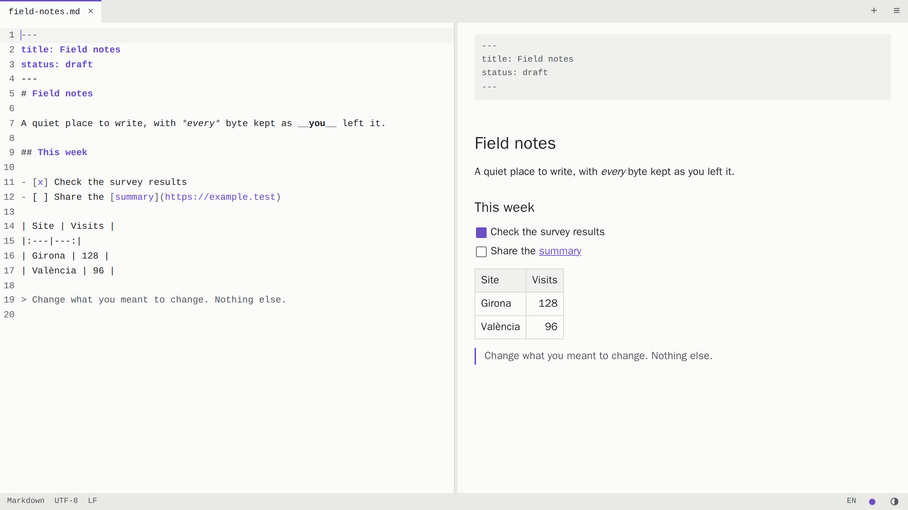
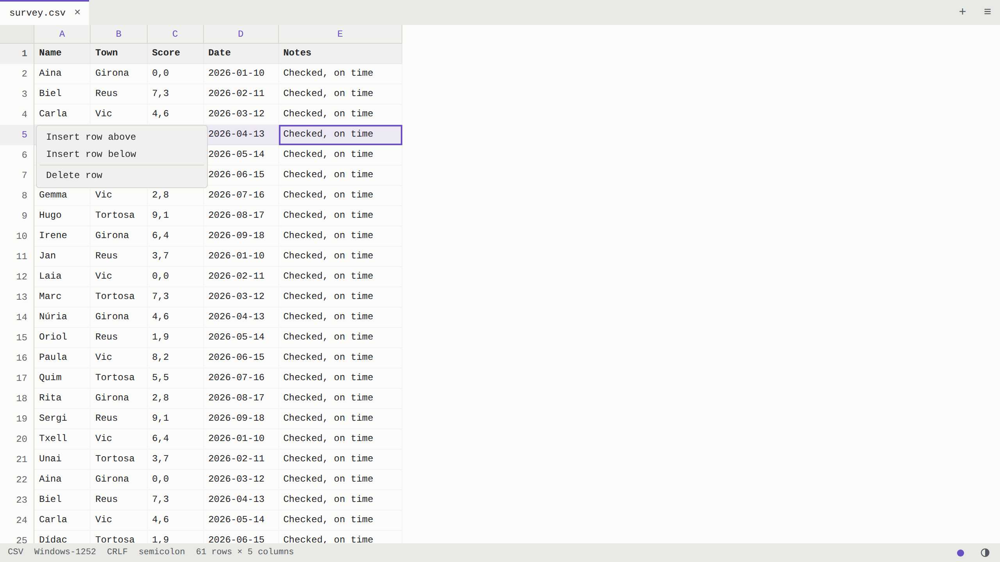
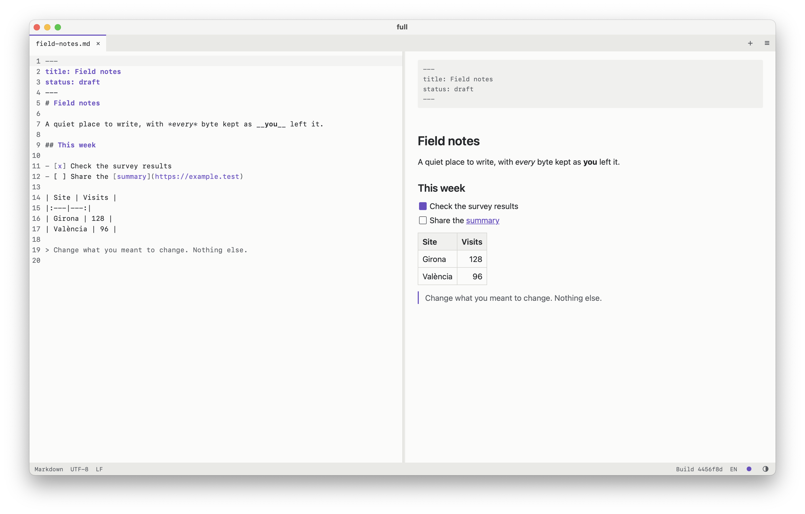

<p align="center">
  <a href="https://full.marcos-a.com">
    <picture>
      <source media="(prefers-color-scheme: dark)" srcset="public/logo-lockup-on-dark.svg">
      
    </picture>
  </a>
</p>

<h3 align="center">The whole file, exactly as you left it.</h3>

<p align="center">
  Open, read, edit and save CSV, Markdown and text files, right in your browser or on your Mac.<br>
  <a href="https://full.marcos-a.com"><strong>Open the app</strong></a> · <a href="#mac-app">Get the Mac app</a>
</p>

<p align="center">
  <strong>English</strong> · <a href="README.ca.md">Català</a>
</p>

<br>

<picture>
  <source media="(prefers-color-scheme: dark)" srcset="docs/screenshots/markdown-dark.png">
  
</picture>

<br>

## Why "full"

**full** — Catalan for *sheet*: *un full* for your notes, *un full de càlcul* for your spreadsheets. The mark is an F that is also that sheet, with one corner folded. The file is the whole point, and everything else stays out of its way.

| **All of it** | **Only it** | **Only yours** |
|:---|:---|:---|
| What you didn't change stays byte for byte: quotes, encoding, line endings, the lot. Editing a cell rewrites that one field. | The file fills the window. There are no toolbars or decoration, just quiet tones with one accent colour. | Files stay in your browser. There is no account and no upload, and an abrupt close doesn't lose your work. |

<br>

<picture>
  <source media="(prefers-color-scheme: dark)" srcset="docs/screenshots/csv-dark.png">
  
</picture>

## What it does

- **Tables:** a CSV grid that handles 100,000 rows. Select, resize, fit, insert, delete and drag rows and columns as you would in a spreadsheet. Semicolons, comma decimals and Windows-1252 from Spanish and Catalan Excel exports work with no configuration.
- **Markdown:** source and rendered views side by side, both editable, with one shared undo history. The source text is always the single source of truth.
- **Text:** a plain editor with line numbers, search and word wrap.
- **Code:** Python, JavaScript, TypeScript, HTML, CSS, C, C++, Java, Rust, Go, PHP, JSON, YAML, XML, SVG and shell scripts open in colour, chosen from the file's extension. In HTML, XML, SVG and PHP, typing `</` finishes the closing tag. Very large files, and files with very long lines such as minified ones, open plain to keep typing instant.
- **Faithful saving:** UTF-8, UTF-16 and Windows-1252 are detected and kept, along with any BOM and the line endings. A character the encoding can't hold stops the save and asks what to do.
- **Recovery:** up to 10 abruptly closed files wait for you at the next launch, with or without unsaved changes.
- **Deleted files:** in Chrome, Edge and the Mac app, if a file you have open is deleted from disk, its tab goes back to unsaved within a couple of seconds, closing it asks first, and Save puts it back where it was.
- **New files:** start writing at once in an unnamed file, and choose its name and type only when you save it, even while others are waiting to be recovered.
- **Your colours:** light and dark themes that follow your system, and five accent tones.
- **Your language:** the interface is in English or Catalan, following your browser.

The few exceptions to "byte for byte" are listed under [Known limitations](#known-limitations). [docs/original-spec.md](docs/original-spec.md) is the original brief; later decisions go beyond it. The product name lives only in [src/config.ts](src/config.ts).

## Keyboard

| Action | Keys |
|---|---|
| Command palette | Cmd/Ctrl+K |
| Open file | Cmd/Ctrl+O |
| New file | Alt+N, and also Cmd+N in the Mac app |
| New Markdown, CSV or text file | Alt+M, Alt+C, Alt+T |
| Save, Save As | Cmd/Ctrl+S, Cmd/Ctrl+Shift+S |
| Undo, Redo | Cmd/Ctrl+Z, Cmd/Ctrl+Shift+Z |
| Select all text | Cmd/Ctrl+A |
| Close file | Alt+W |
| Grid: edit a cell | Enter, F2, or start typing |
| Grid: new line inside a cell | Alt+Enter |
| Grid: select row, column, all | Shift+Space, Ctrl+Space, Cmd/Ctrl+A |
| Grid: move rows or columns | "Move selected…" commands in the palette |
| Grid: resize column or row | Alt+Shift+Arrow keys, or drag its edge |
| Grid: fit column or row to its content | Double-click its edge |
| Grid: insert or delete selected rows or columns | Cmd/Ctrl+Alt+=, Cmd/Ctrl+Alt+- |

Every command is in the palette and in the menu at the end of the tab bar. The start screen and the menu's tooltip both show the palette's shortcut, though touch screens don't get the start screen hint.

The + button at the end of the tab bar lists the ways to open or create a file. A new file opens without asking anything: "New file", on the start screen, in that menu or in the palette, gives you an empty tab called "untitled" to type in. It stays there, protected by recovery, until you save it or discard it. The extension you give it when saving decides whether it carries on as Markdown, CSV or text. Saving with no extension shows a warning you can go past or turn off, and any text file opens, as plain text if its extension is missing or unfamiliar. Binary files such as images are refused. In the Mac app, the first save to a file that isn't CSV, Markdown or text asks first, in a native dialog that names its full path. To start with a type already chosen, use "New Markdown file", "New CSV file" or "New text file". A new CSV opens as a small table, using semicolons where the locale's decimal mark is a comma, plus CRLF and a UTF-8 BOM so that Excel reads it correctly. Files pending recovery stay in the list until you restore or discard them, so you can open or create other files first.

Choose an accent tone (violet, the default, or blue, green, orange or coral) with the dot in the status bar. It applies to both themes, the logo, the tab icon and the colours of Markdown files, and is remembered. Safari and installed-app icons stay violet, because they use fixed image files.

The app follows the system's light or dark setting. The half-circle button in the status bar switches to the other theme and remembers the choice. Switching back to the theme the system has returns to following the system, as does "Theme: follow system" in the palette.

The interface uses the first of your browser's languages that it has, English or Catalan, and English otherwise. To change it, click the language label (EN or CA) in the status bar, or use "Language: English" or "Language: Català" in the palette. The choice is remembered, and picking your browser's language returns to following the browser.

In the grid, click a row number or column letter to select it, and drag across several to select them. Shift+click extends the selection and Cmd/Ctrl+click adds or removes separate rows or columns. Drag from inside a selection to move all of it, and press Escape to cancel. With several selected, dragging or double-clicking the edge of any of them resizes them all. Right-click for a menu to insert, delete, fit or set an exact size; on a touch screen, tap. Row heights and column widths only change the view and are never saved in the file, and undo takes a resize back like any other change.

## Browser support

| Browser | Save | Save As |
|---|---|---|
| Chrome, Edge | Overwrites the original file | Native save dialog |
| Safari, Firefox | Downloads a copy, labelled "Download" | Download with an editable name |

HTTPS or `localhost` is required: saving over files, Web Locks and the async clipboard only work in a secure context.

## Mac app

full also runs as a native Mac app, built from the same code as the website. Download it from the [latest release](https://github.com/Marcos-A/full/releases/latest). It isn't on the App Store, and Apple hasn't checked it, so check the download as described below before you install it.

<picture>
  <source media="(prefers-color-scheme: dark)" srcset="docs/screenshots/mac-app-dark.png">
  
</picture>

**What it adds to the website:**

- Double-click a Markdown or CSV file in Finder, or use Open With, to open it in full. Finder also offers it under Open With for any other text file, such as `.txt`, HTML or Python, without making it the default. To make it the default for one of those types, use Get Info and Change All, as described below. A file with no extension doesn't count as text to macOS, so Finder doesn't offer full for it: drag it onto full's window or Dock icon, or use "Open file" in full.
- Save always writes over the original file, keeping its permissions, Finder tags and creation date, and it asks first if another app has changed the file since.
- Native menus, in English or Catalan to match the app.
- It works fully offline and never loads the website.
- Closing the window, Cmd+Q, Dock Quit and logout all ask about unsaved files first. Force Quit, a crash or a power cut can't be held back, and recovery covers those: it has everything up to half a second after you stop typing, and at most 3 seconds behind during steady typing.

**Needs:** macOS 15 or later, on Apple Silicon or Intel. It has only been tried by hand on Apple Silicon, and the Intel version has only been started by the automated build.

### Checking the download

The app has no Apple signature, which costs $99 a year, so macOS can't tell you who made it. These checks do that instead. Each release is immutable: once it's published, its files can't be replaced, and GitHub keeps a signed record of them. The DMG also has a signed record of the workflow and commit that built it.

1. Download the DMG from the [latest release](https://github.com/Marcos-A/full/releases/latest). Its name ends with the version and the build, such as `full_0.1.0_universal_563745f.dmg`.
2. **Quick check, nothing to install.** Open Terminal (in Applications > Utilities), type `shasum -a 256` and a space, drag the DMG onto the Terminal window and press Return. The long code it prints must match the `sha256:` shown next to the DMG on the release page. This shows your file is the one published there.
3. **Full check, with a GitHub account.** Install the [GitHub CLI](https://cli.github.com) (`brew install gh` with Homebrew) and run `gh auth login` once. Then run these lines in Terminal, with the release's version in the second one:

   ```
   cd ~/Downloads
   gh release verify-asset v0.1.0 full_*.dmg --repo Marcos-A/full
   gh attestation verify full_*.dmg --repo Marcos-A/full --signer-workflow Marcos-A/full/.github/workflows/desktop.yml --source-ref refs/heads/main
   ```

   If Downloads holds more than one full DMG, write the file's whole name instead of `full_*.dmg`. Both checks must say that verification succeeded. The first shows the file belongs to that release. The second shows it was built on GitHub's servers by this repository's workflow, from its `main` branch, and not on anyone's own computer.

If a check fails, don't install the app, and [open an issue](https://github.com/Marcos-A/full/issues).

These checks prove the app was built from this repository's public code, with nothing added on the way. They don't prove that code is safe, which is yours to judge, and unlike Apple's notarization, nobody has scanned it for malware.

### Installing it

macOS won't open the app until you tell it to. Only do this with a download that passed the checks above.

1. Double-click the DMG and drag `full` into the Applications folder. Then eject the DMG in Finder.
2. Open Terminal (in Applications > Utilities), paste this line and press Return:

   ```
   xattr -dr com.apple.quarantine /Applications/full.app
   ```

   This tells macOS to skip its download check for this app only.
3. Open full from Applications. The status bar at the bottom shows its version and build.

To make full the app that opens all your Markdown files on double-click, select one in Finder, press Cmd+I, choose full under "Open with" and click Change All. The same works for CSV files and any other kind of text file, such as `.txt`, `.html` or `.py`.

**Updating:** quit full, download and check the new DMG, then repeat the install steps, replacing the old app. Files waiting to be recovered carry over. The app doesn't update itself.

**Removing it:** drag `full` from Applications to the Trash. Its recovery data is in `~/Library/WebKit/com.marcos-a.full/`, and its list of files that can be restored is in `~/Library/Application Support/com.marcos-a.full/`. Delete both to remove everything.

**Privacy:** nothing leaves your Mac. Recovery data stays on the Mac unencrypted, as the website's does in a browser. To save a restored file back over the original, the app keeps a plain-text list of the paths of files it has opened.

## Privacy and shared computers

The app makes no requests containing file content, and has no analytics or external error reporting. Remote images in Markdown are blocked until you run "Load remote images" for that file, because loading them reveals your IP address to those hosts.

**Recovery data is stored unencrypted in the browser profile**, including files you never edited. On a shared computer, run "Clear all recovery data" from the recovery list when you finish, which removes it entirely. Files still open in another tab are not affected until that tab closes.

---

## Development

Node and browsers aren't needed on the host: [scripts/in-docker.sh](scripts/in-docker.sh) runs any command in the Playwright image.

```sh
scripts/in-docker.sh sh -c 'mkdir -p /tmp/home && npm ci'
scripts/in-docker.sh npm test                 # unit tests (Vitest)
scripts/in-docker.sh npm run test:e2e         # Chromium, Firefox, WebKit
scripts/in-docker.sh npm run test:perf        # timing targets, on an otherwise idle machine
```

Both Playwright commands build first, then test that production build through `vite preview`, under the real Content Security Policy. They start their own servers and stop if the ports are already in use, so they can't end up testing another checkout. To check the deployed site instead:

```sh
BASE_URL=https://full.marcos-a.com scripts/in-docker.sh npx playwright test --project=chromium e2e/privacy.spec.ts
```

`test:e2e` also runs the save flows on WebKit against a stand-in for the desktop app's native file access. `npm run build` compiles it into a separate `dist-native-fake/` bundle, which never reaches the website.

The [Mac app](#mac-app) uses Tauri 2 and the same frontend as the website: the native side is in `src-tauri/` and its entry point in `src/desktop/`. Its bundle goes to `dist-desktop/`, which never reaches the website, and is packaged inside the app, so the app never loads the deployed site.

Its menus come from `src-tauri/src/menu_table.rs`, and the page only says which items apply. To save a restored file back over the original, the app asks with a native confirmation naming the path, from a list Rust keeps in `~/Library/Application Support/com.marcos-a.full/`. Started with `FULL_TIMINGS` set, it prints launch, open, typing and save times to stderr; the [audit](docs/desktop/repository-audit.md#m6-finder-and-packaging-results) has how the budgets were measured.

Builds run on GitHub Actions in [desktop.yml](.github/workflows/desktop.yml), on every push to a `desktop-*` branch, or from the Actions page once the workflow is on `main`. It tests the native code, builds a universal DMG and checks that the built app starts, under Rosetta too. It also asks macOS which file types it would offer the app for. It produces `full-dmg-<commit>`, and `full-inspector-dmg-<commit>`, the same app named "full inspector" with Web Inspector on, for reading console errors on a Mac. It has its own identifier, `com.marcos-a.full.inspector`, so macOS never opens files meant for full in it, and it keeps its own recovery data. Both have an ad hoc signature, so they're for testing only. The DMG names end with the commit too, so an old download can't pass for a new one.

CI deletes those files after 14 days. To keep a build, open the Actions page, choose Desktop build, then Run workflow, pick the branch and tick "release". When it finishes, the DMG is under Releases as `mac-<commit>`, marked as a pre-release, with its SHA-256 shown next to it. Like the repository, releases are public, so a test pre-release can be downloaded by anyone, though the README only points to full releases.

To publish a version, run it on `main` with the version in the "version" box instead, such as `v0.1.0`, matching `package.json`. It needs the repository to be public and "Enable release immutability" to be on in its settings, and it checks both before building. The build then gets a signed attestation of the workflow and commit it came from, the app's status bar shows the version, and the release can't be changed once it's published. Its last step runs the checks from [Checking the download](#checking-the-download).

On a Mac with Rust and the Xcode tools, use `npm run desktop:dev`, `desktop:build` and `desktop:test`.

With Node 24 or later installed, `npm run dev` starts a dev server. Use the same versions for tests: older Node releases such as 22.16 decode Windows-1252 wrongly, which fails the encoding tests even though browsers are fine. Over SSH, use a tunnel to `localhost` so that the page stays a secure context.

README screenshots come from the current build and use sample data, so retake them whenever the interface changes:

```sh
scripts/in-docker.sh npm run docs:screenshots
```

The Playwright version in `package.json` and the image tag in `scripts/in-docker.sh` must match.

## Deployment

The site runs as an nginx container that serves the built files, bound to a localhost port behind the host's reverse proxy, which handles TLS. The image is built entirely in Docker.

| Setting | Default | Variable |
|---|---|---|
| Host port | `8098` | `HOST_PORT` |
| Container name | `full-web` | `CONTAINER_NAME` |
| Image | `full-web:local` | `IMAGE_NAME` |

**First deployment:** point the reverse proxy at the port, for example with Caddy:

```caddyfile
full.marcos-a.com {
	reverse_proxy 127.0.0.1:8098
}
```

**Deploy or update:**

```sh
git pull
scripts/deploy_production.sh
```

The script refuses uncommitted changes, builds the image with the commit SHA, starts the container, writes the build metadata and checks that the container answers. Security and cache headers are set in [deploy/nginx.conf](deploy/nginx.conf) and [deploy/security-headers.conf](deploy/security-headers.conf).

**Roll back:**

```sh
git checkout <commit>
scripts/deploy_production.sh
git checkout main
```

**Keep the origin stable.** Recovery data belongs to the origin, so changing the domain, subdomain or port leaves it behind.

## Build information

The status bar shows the deployed commit, such as `Build 05f2e39`, or `v1.0.0 · 05f2e39` once a release exists. If the metadata is missing it shows `Build unknown`, and the app works normally. The full metadata is at `/build-info.json`.

The deploy script writes that file to `build-meta/` on the host, which the container mounts read-only. Deployments don't create releases. After publishing a GitHub release, update what's shown without rebuilding:

```sh
scripts/write-build-info.sh "$(git rev-parse HEAD)"
```

The Mac app's build writes the same file into its bundle, with `desktop` as the environment. A build for a public release also records that release, so its status bar shows the version, such as `v0.1.0 · 35ff77a`. Test builds show `Build` and the commit. The version number, `0.1.0` for now, comes from `package.json` and shows in Finder.

`build-env.sh` and `update-release-info.sh` are copies from the shared `app-build-info` convention, so change them there rather than here.

## Brand assets

The icons, logos, wordmarks and web manifest are in [public/](public/).

## Tests and manual checks

The Playwright suite covers each acceptance criterion in section 11 of the [original brief](docs/original-spec.md); test names start with its number, such as `AC14`. Tests tagged `@cross` also run on Firefox and WebKit.

Native file dialogs can't be automated, so the "overwrite the original" tests stub only the pickers and write through real `FileSystemFileHandle` objects from the browser's private file system. These checks need a real browser and are still to be run:

| Check | Steps | Result |
|---|---|---|
| Overwrite after permission | In Chrome or Edge: open a file with the button, edit, save, accept the prompt, then check the file on disk | Not yet run |
| Drop keeps its handle | In Chrome or Edge: drag a file from the desktop, edit, save, and check that it overwrites with no save dialog | Not yet run |
| Permission after restore | Restore a file after a crash and save: it should ask for permission, and fall back to Save As if refused | Passed in Edge: saving over the file after allowing, and the Save As fallback |
| Paste into spreadsheets | Copy a range and paste it into Excel, Google Sheets and Word; copy from Excel and paste it into the grid | Not yet run |
| Dead keys | On a Spanish or Catalan keyboard, type `à` straight into a selected grid cell. The test composes text through Chromium and sends no real key | Passed on a real keyboard in Safari, Chrome and the Mac spike |
| Real Safari | Repeat the main flow in Safari. Automated runs use Playwright's WebKit build | Not yet run |
| Mac app shell | With the network off, start the Mac app; in the inspector build, check the Console for CSP violations; click web and mail links | Passed on macOS 26.7.1, build `fd4494c` |
| Mac app open | With the Open panel, Finder drops and `open -a`, open supported, unsupported and already open files; from the inspector build's Console, try to read a path | Passed on the M4, build `b819dad`. A real double-click and Open With passed in M6 |
| Mac app save | Edit and save over originals, including in an iCloud folder; change a file from another app and try each conflict choice; save a read-only and a locked file; check that mode, tags and creation date survive | Passed on the M4, build `8906b37` |
| Mac app close and quit | With the red button, Cmd+Q and Dock Quit, try Cancel, Don't save, Save and a failed Save; log out with unsaved work; check Cmd+W and Option+W; Force Quit, restore offline and save; install a higher version over it and restore | Passed on the M4, builds `461ec0a` and `0ccf8f4`, and `2a77728` for the update |
| Mac app in Finder | In a new macOS user with Wi-Fi off, double-click a file with the app closed and another with it open; use Open With, cold and warm; check that `.txt` offers the app without it being the default, and `.py` doesn't; drop supported and unsupported files together; save | Passed on the M4, build `52a2de0` |
| Mac app menus | Use every File, View, Table, Edit and Window item, including Select All on a table and in a cell; switch the app to Catalan; check that Cmd+W, Cmd+Q and Dock Quit still ask | Passed on the M4, builds `52a2de0` and `563745f` |
| Mac app, other text files | Open a `.py`, an `.html` and a file with no extension from Finder; check that an image is refused; edit each and save, which should ask once in a native dialog naming the path; Save As a new name with no extension and check it stays as typed; make full the default for `.py` with Change All | Passed on the M4, build `4456f8d`. Finder doesn't offer full for the file with no extension, because macOS doesn't count it as text; dragging it onto full opens it |
| Deleted file | With a saved file open in the Mac app and in Chrome or Edge, delete it, move it to the Trash and rename it, with the app in front and behind. The tab should go unsaved, closing should ask, and Save should put it back. In Chrome, check whether it comes back at the same path or goes to Save As | Passed on the M4, build `4456f8d`, and in Chrome, where Save put the file back at the same path |
| Mac app public download | Download the DMG from the latest release, follow [Checking the download](#checking-the-download) and the install steps as a new user would, and check the version in the status bar | Passed on the M4, `v0.1.0` (`35ff77a`) |

## Known limitations

- **Mixed line endings:** files keep their exact bytes until edited. The first saved edit in a source editor may convert them to the dominant style, and the status bar warns about this. Grid edits don't convert them.
- **Multi-line CSV cells in raw view:** a CRLF file with LF inside quoted cells counts as mixed, so editing it in raw view may convert those. Editing it in the grid doesn't.
- **Rendered-side edits reformat:** they regenerate the file's Markdown, as the warning says. It doesn't appear for never-saved or empty files, which have no existing formatting to protect. Front matter and the final-newline state are kept, and undo restores the exact previous text.
- **Undo in CSV:** the grid and raw view have separate histories. Changes made in raw view arrive in the grid as one undo step, and leaving raw view clears its own history.
- **Moving columns in uneven rows:** a row shorter than the moved column stays as it is. Otherwise it gains only the empty fields needed to keep its values in the right columns.
- **Undo after restoring:** undo history doesn't survive a restore or an encoding change.
- **Very large Markdown:** rendered-side edits serialize the whole document, so in a 1 MB file they lag behind typing, by design without ever losing text. Source-side typing isn't affected. Files over 100 KB parse section by section, and stay whole if they contain anything that can span sections, such as reference links or HTML comments.
- **Relative images and links:** relative image paths show a placeholder, because a browser page can't read neighbouring files. Relative links don't navigate.
- **Task checkboxes** in the rendered side are drawn with CSS, so they toggle by mouse only. Their text can be edited by keyboard, and so can the `[x]` in the source.
